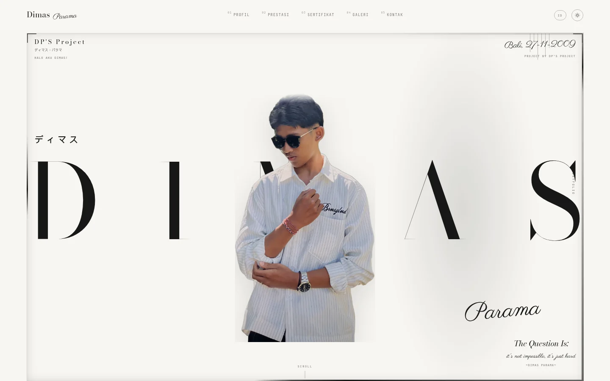
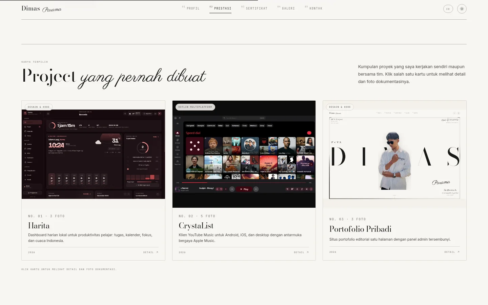

Situs portofolio editorial satu halaman dengan panel admin rahasia, dibangun
dengan **Laravel 13** dan **SQLite**. Desain, tipografi, dan animasinya sengaja
tenang dan bersih: nama besar di hero, banyak ruang kosong, dan gerak yang tidak
berisik.





## Fitur

- **Panel admin tersembunyi** — tidak ditautkan di halaman mana pun. Buka dengan
  lima ketukan pada logo di navbar, `Ctrl/Cmd + Shift + A`, atau alamat rahasia.
- **Semua bisa diedit** — teks, foto, urutan bagian, nama, biografi, riwayat
  pendidikan, prestasi, project, sertifikat, keahlian, galeri, kontak, footer.
- **Tiga tema** — terang, gelap, dan midnight, dengan transisi riak melingkar.
  Pilihan pengunjung disimpan di perangkatnya.
- **Bahasa ID ⇄ EN** — terjemahan otomatis di server, di-cache di tabel
  `translations`, jadi teks baru dari panel pun ikut diterjemahkan.
- **Project** — kartu dengan sampul, lalu panel detail berisi cerita, peran,
  tahun, tautan, dan galeri foto dokumentasi.
- **Upload gambar** — dikompres ke WebP di browser sebelum dikirim, dengan opsi
  hapus latar (berjalan di browser).
- **Marquee adaptif** — teks berjalan hanya saat meluap, jadi tidak pernah
  terpotong. Berlaku untuk strip hero dan wordmark footer.
- **Bingkai hero beranimasi** — sweep conic yang menyapu keliling, garis cahaya,
  siku sudut, dan pendar lembut.
- **Kunjungan** — penghitung kecil di footer, satu pengunjung dihitung sekali.
- **GitHub** — repositori publik tampil di bagian keahlian (di-cache 15 menit).
- **API JSON** — kontrak `x-admin-token`, konten di satu kolom JSON dengan
  riwayat 20 revisi.

## Menjalankan

Butuh PHP 8.2+ dan Composer.

```bash
composer install
cp .env.example .env
php artisan key:generate
php artisan migrate
php artisan serve
```

Buka <http://127.0.0.1:8000>.

Database SQLite otomatis dibuat di `database/database.sqlite`. Tidak ada
`npm install` dan tidak ada build step — semua aset ada di `public/`.

### Panel admin

| Cara | Aksi |
| --- | --- |
| Gestur | Ketuk logo **Dimas** di navbar 5× dalam 3 detik |
| Pintasan | `Ctrl/Cmd + Shift + A` |
| Langsung | Buka `/panel-dim4s` |

Password awal **`admin123`**, diatur lewat `ADMIN_PASSWORD` saat pertama kali.
Ganti path dan password lewat `.env`:

```env
ADMIN_PATH=nama-rahasia-kamu
ADMIN_PASSWORD=password-awal
```

Halaman publik tidak memuat path admin sama sekali — gestur dan pintasan menuju
alias `/kelola` yang hanya melakukan redirect di server, jadi `ADMIN_PATH` tidak
terlihat di HTML.

## Struktur

```
app/
  Http/Controllers/   SiteController, AdminController, ApiController
  Models/             SiteContent, ContentRevision, Setting, Media, Translation, Visit
  Support/            ContentRepository, AdminAuth, TranslationService
config/portfolio.php  path admin, password awal, batas upload
resources/content/    defaults.json — isi awal situs
resources/views/site/ index.blade.php, admin.blade.php
public/               assets, css, js
```

Isi awal situs ada di `resources/content/defaults.json`, jadi setelah
`php artisan migrate` halaman langsung tampil lengkap tanpa seeding manual.

## API

| Method | Path | Fungsi |
| --- | --- | --- |
| `GET` | `/api/meta` | status login & izin edit |
| `POST` | `/api/login` | `{password}` → `{token}` |
| `PUT` | `/api/content` | simpan konten |
| `GET` | `/api/content/translated?locale=en` | konten versi Inggris |
| `POST` | `/api/upload` | `{dataUrl}` → `{url}` |
| `POST` | `/api/visit` | `{token}` → `{count}` |
| `GET` | `/api/github/{user}` | ringkasan profil & repo GitHub |

Token dikirim sebagai header `x-admin-token`.

## Lisensi

Kode boleh dipakai dan diubah bebas. Foto, tulisan, dan identitas di dalamnya
milik Dimas Parama — jangan dipakai ulang sebagai milik sendiri.
